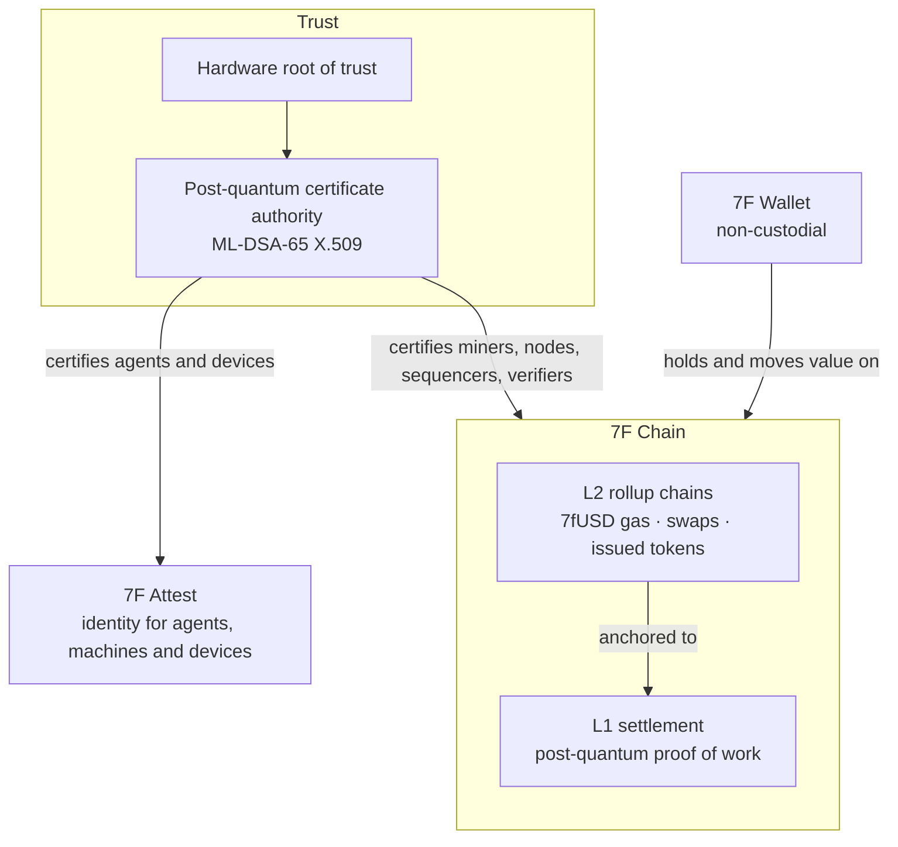

# Seven Fortunas

**Military-grade, post-quantum native infrastructure for the future of value flows.**

One vertically integrated stack: Layer 1 (L1), Layer 2 (L2), wallet and identity, with no vendor seams between chain, custody, wallet and identity. Post-quantum cryptography is built in from genesis, not retrofitted.

## Start here

| I want to… | Go to |
|---|---|
| ⛏️ Mine 7fchain on the testnet | [Become a miner](https://github.com/Seven-Fortunas/7fchain/blob/main/docs/become-a-miner.md): free certificate, ordinary computer |
| ⬇️ Download the node | [Latest testnet release](https://github.com/Seven-Fortunas/7fchain/releases/latest) |
| 🔎 Watch the network | [Network explorer](https://explore.sevenfortunas.com/) |
| 📖 Understand why and how | [Mission & Design](https://github.com/Seven-Fortunas/7fchain/blob/main/papers/7fchain-mission-and-design.md), then the [papers](https://github.com/Seven-Fortunas/7fchain/tree/main/papers) |
| 🤝 Evaluate us as an investor or partner | [Executive Summary](https://github.com/Seven-Fortunas/7fchain/blob/main/papers/7fchain-executive-summary.md) and [sevenfortunas.com](https://sevenfortunas.com) |
| 💬 Ask a question | [Q&A on 7fchain Discussions](https://github.com/Seven-Fortunas/7fchain/discussions/categories/q-a) |
| 🛡️ Report a vulnerability | [Security policy](https://github.com/Seven-Fortunas/.github/blob/main/SECURITY.md), privately, never in a public issue |

## The stack

## What we build

**7F Chain L1.** A sovereign Layer 1 with certificate-gated, CPU-mineable proof of work. ML-DSA-65 on every transaction, address, certificate, handshake and governance operation, and ML-KEM-768 for the session keys between nodes. Testnet live, with our post-quantum certificate authority (CA) issuing miner certificates. → [7fchain](https://github.com/Seven-Fortunas/7fchain)

**7F Chain L2.** Post-quantum rollup chains anchored to the L1, each with its own sequencer, independent verifier and data availability. Testnet live. Supports issued tokens with governed mint authority, peer-to-peer transfers, an order book and atomic swaps, with 7fUSD as the default gas token.

**7F Attest.** Post-quantum identification and authentication for autonomous agents, machines and connected devices, issued by our CA.

**7F Wallet.** Non-custodial wallet for consumer and enterprise use.

**Hardware root of trust.** Every certificate on the network traces back to keys held offline on [7F Signers](https://github.com/Seven-Fortunas/7f-signer), air-gapped signing devices, and no single holder can act alone. For miners and users, that means certificates can't be forged and no one party can rewrite the network's rules. Every node checks every certificate against trust anchors built into its software. And the root of trust can't touch your funds: no one, the certificate authority included, can move, freeze or seize coins an honest holder owns.

**Tokenized EdTech platform.** Offline-first learning with token-based rewards, built for low-connectivity regions and entry-level devices.

## Who it serves

**Sovereign.** Post-quantum identity for autonomous systems, and compliant, auditable disbursement for agencies and development finance institutions (DFIs).

**Enterprise.** Cross-border business-to-business (B2B) settlement, as rail-as-a-service inside partner banks or enterprise-direct.

**Consumer.** Cross-border value transfer into closed-loop tokens redeemed at partner merchants. Tokenized EdTech platform to incentivize students.

## Standards

Post-quantum posture aligned with NIST FIPS 203 (ML-KEM) and FIPS 204 (ML-DSA) and the Commercial National Security Algorithm Suite (CNSA) 2.0.

## Repositories

| Repository | What's there |
|---|---|
| [7fchain](https://github.com/Seven-Fortunas/7fchain) | Testnet releases, [miner guides](https://github.com/Seven-Fortunas/7fchain/tree/main/docs), [troubleshooting](https://github.com/Seven-Fortunas/7fchain/blob/main/docs/troubleshooting.md) and the [papers](https://github.com/Seven-Fortunas/7fchain/tree/main/papers) |
| [7f-signer](https://github.com/Seven-Fortunas/7f-signer) | The 7F Signer, our post-quantum air-gapped signer, and its [key-ceremony page](https://seven-fortunas.github.io/7f-signer/) |

## Connect

- 🌐 Website: [sevenfortunas.com](https://sevenfortunas.com)
- 💬 Questions: [7fchain Discussions](https://github.com/Seven-Fortunas/7fchain/discussions)
- ✉️ Contact: build@sevenfortunas.com
- 🛡️ Security reports: security@sevenfortunas.com ([security policy](https://github.com/Seven-Fortunas/.github/blob/main/SECURITY.md))
- 📍 United States
